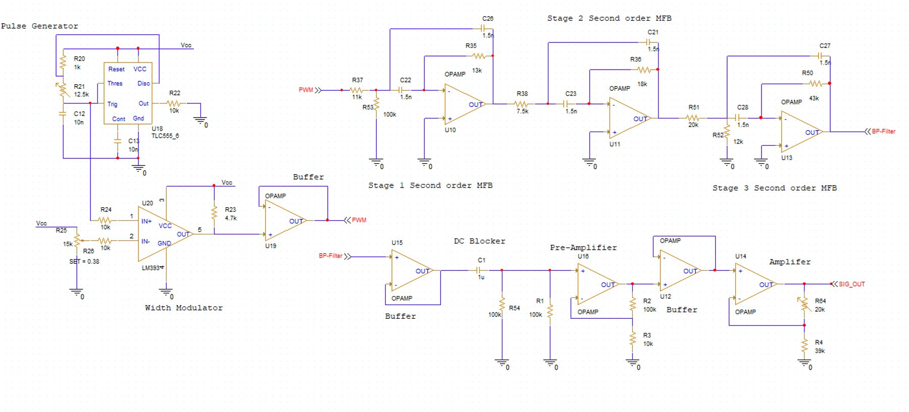
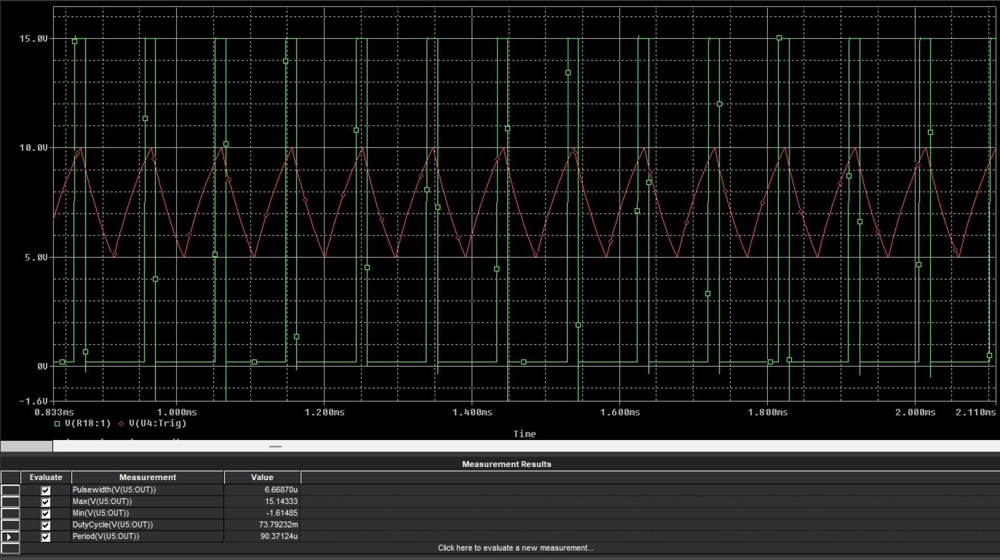
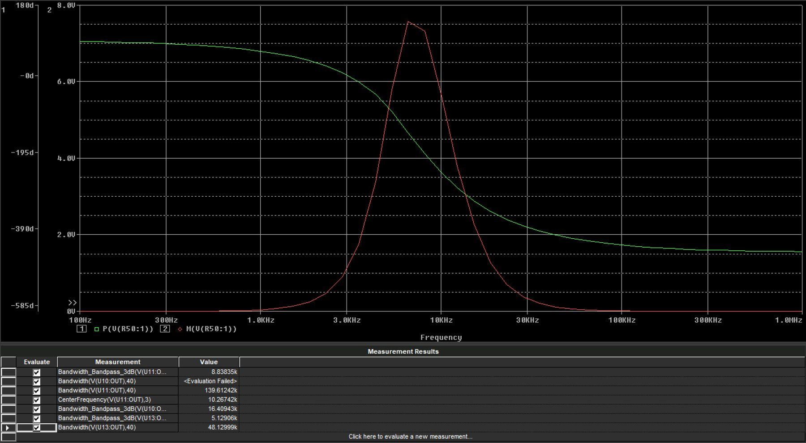
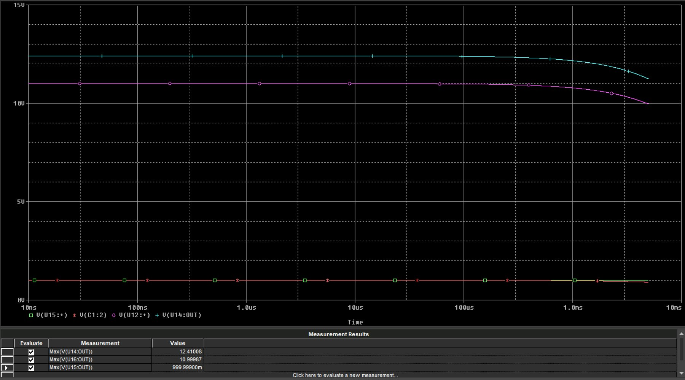
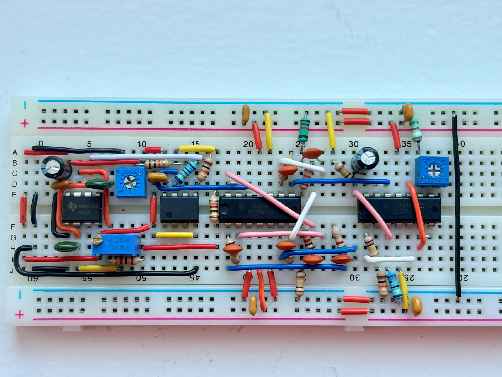
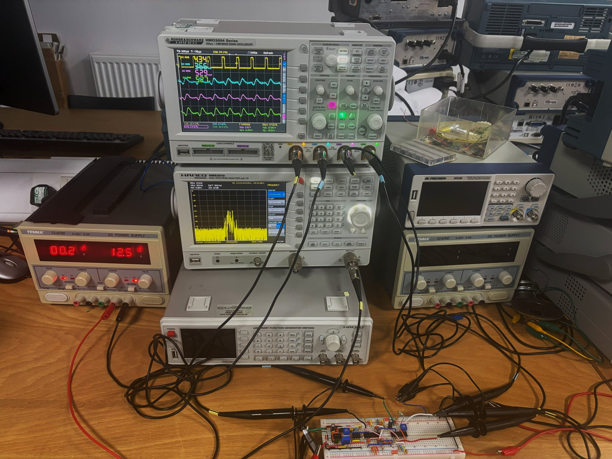
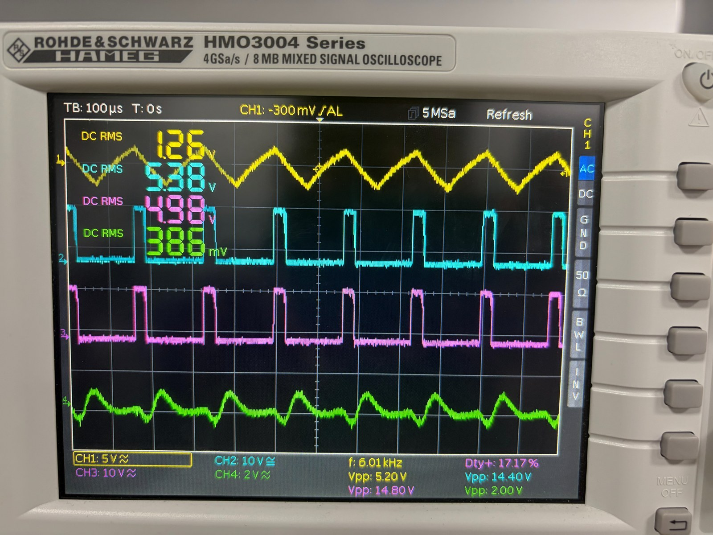
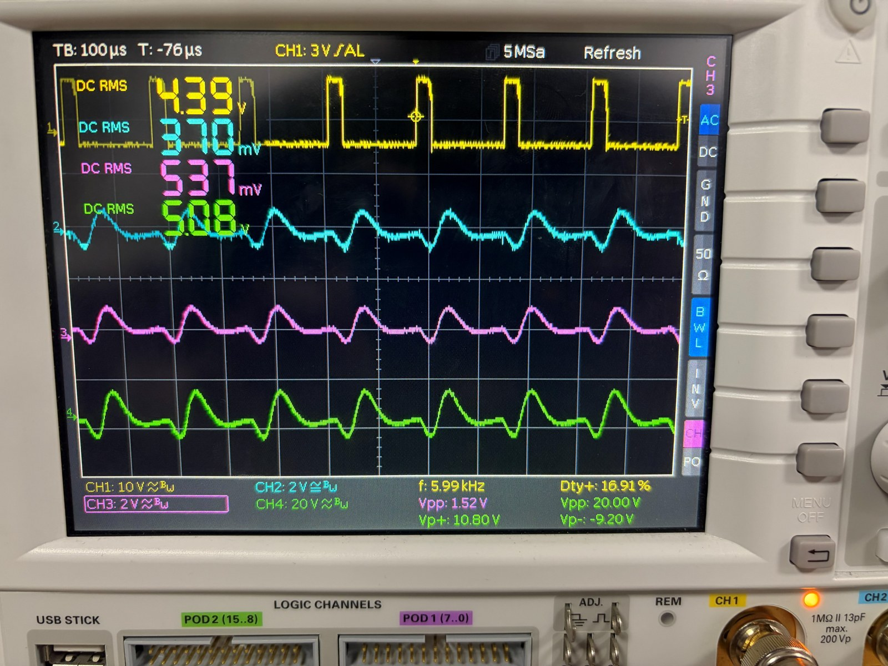

# 555 PWM Signal Generator with Independent Frequency and Duty Control

BEng (Hons) Electronic Engineering, Year 2 — *SEF515 Electronic Circuits*, Solent University (2025–26).
Author: Nikhil Renny. **Mark: 83%** — see [marker feedback](docs/FEEDBACK.md).

A three-stage analogue signal chain, designed, simulated in PSpice and built and measured on a breadboard:

```
555 + LM393 PWM  ->  buffer  ->  6th-order Butterworth MFB band-pass  ->  DC block  ->  gain stages  ->  20 Vpp output
(1–100 kHz, D=17%)                (3 x 2nd-order, TL074)                                (x ~16, adjustable)
```



## Specification

| Stage | Requirement |
|---|---|
| PWM | 1 kHz – 100 kHz, independently adjustable duty cycle, **D = 17%** (from the last two digits of the student ID) |
| Band-pass filter | 0 dB passband gain, 5 kHz bandwidth (−3 dB), −40 dB at 100 kHz |
| Output | 20 Vpp, centred on 0 V, adjustable gain |

## Design summary

**PWM.** NE555/TLC555 astable generates a ramp (1/3–2/3 Vcc); an LM393 comparator slices it against an adjustable DC reference to set duty cycle independently of frequency. `f = 1.44 / ((R1 + 2·R2)·C1)` with R1 = 1 kΩ, C1 = 10 nF, R2 variable. A buffer isolates the PWM from the filter.

**Filter.** 6th-order Butterworth, realised as three cascaded second-order multiple-feedback (MFB) band-pass sections (TL074), C = 1.5 nF, f0 ≈ 10 kHz. Stage Qs from the Butterworth coefficients (1.932, 1.414, 0.517): 0.517, 0.707, 1.932. A 4th-order version failed the −40 dB requirement in simulation, hence 6th order. Resistor values were tuned empirically after the calculated R2 values were not realisable for stages 1–2 (see feedback).

**Output.** Buffer → 1 µF / 100 kΩ DC block (≈1.6 Hz) → non-inverting pre-amp (×11) → buffer → adjustable non-inverting stage (39 kΩ + 20 kΩ trimpot).

**Key feature: fully independent, continuously variable frequency and duty cycle.** Frequency is tuned with a single potentiometer (1–98 kHz measured) and duty cycle with a separate comparator reference trimpot, so neither control affects the other. Measured duty stayed at 16.8–17.9% across the whole frequency sweep with no component changes.

## Results

### Simulation (PSpice)

| Parameter | Target | Simulated |
|---|---|---|
| PWM ramp frequency | ≈10 kHz | 11.07 kHz |
| Duty cycle | 17% | ≈17% (pulse ≈15.5 µs) |
| Comparator swing | 0–15 V | 0.2–15.0 V |
| Filter centre frequency | 10 kHz | 10.27 kHz |
| Filter −3 dB bandwidth (stage 3) | 5 kHz | 5.13 kHz |
| Filter −40 dB bandwidth (stage 3) | — | 48.13 kHz |

| PWM transient | Filter AC sweep / Bode | Output stage |
|---|---|---|
|  |  |  |

More plots: [`images/simulation/`](images/simulation).

### Hardware (breadboard)





| Parameter | Target | Simulation | Measured |
|---|---|---|---|
| Duty cycle | 17% | 17.4% | 16.8–17.9% |
| Filter centre frequency | 10 kHz | 10.27 kHz | **≈5–6 kHz** |
| Filter −3 dB bandwidth | 5 kHz | 5.13 kHz | **≈11 kHz** |
| Amplifier gain | ×16 | ≈×11–12 (no load) | ×16–17 (24.1–24.5 dB) |
| Output DC offset | 0 V | <50 mV | −108 to −355 mV |
| Output swing | ≤ ±12 V | not observed | 20–20.8 Vpp, **clipping near filter peak** |

| 555 + 393 + buffer + filter @ 6 kHz | Full chain @ 6 kHz |
|---|---|
|  |  |

All oscilloscope captures: [`images/hardware/scope_pwm_filter/`](images/hardware/scope_pwm_filter) (PWM/filter sweep) and [`images/hardware/scope_full_chain/`](images/hardware/scope_full_chain) (full chain with Vpp/mean/Vp± measurements). Raw numbers: [`data/`](data).

## Analysis and lessons learned

- **Filter shifted down ~2× and broadened.** The measured response peaks at ≈5–6 kHz with ≈11 kHz bandwidth versus 10 kHz / 5 kHz designed. Cause: tolerance stacking in the 1.5 nF ceramic capacitors and resistors across three cascaded MFB stages, finite TL074 gain-bandwidth, inter-stage loading and breadboard parasitics.
- **Offset and clipping.** TL074 input offset, amplified by the gain stages, produced a negative DC offset at the output; with the filter's higher-than-simulated peak amplitude, the output clipped on the supply rails near 2–8 kHz. About 6 dB less gain restores headroom.
- **What I'd do differently** (also the marker's main points): derive the full transfer function and pole locations tied to the −40 dB requirement instead of tuning by hand; run Monte-Carlo / worst-case tolerance analysis in the design phase (C0G caps, 1% resistors); add an offset-nulling or second coupling stage; move to a PCB to cut parasitics.

## Repository layout

```
images/
  schematics/   block diagram + PWM, filter, output and full-system schematics
  simulation/   PSpice plots (pwm/, filter/, output/)
  hardware/     setup/ (photos + key scope shots), scope_pwm_filter/, scope_full_chain/
data/           measurement tables as CSV (PWM+filter sweep, full chain, 555 frequency/duty tests)
docs/           marker feedback
```

## Bill of materials (summary)

NE555/TLC555, LM393, 2 × TL074 (7 op-amps used); 6 × 1.5 nF C0G (filter), 2 × 10 nF C0G (PWM), 1 µF film (DC block); 1% metal-film resistors (1 kΩ–100 kΩ), 100 kΩ linear pot (frequency), 15 kΩ trimpot (duty cycle), 20 kΩ trimpot (output gain); 12.5 V supply for the PWM stage and ±15 V dual supply for the analogue stages.

## Tools

PSpice (simulation), bench oscilloscope and dual supply, breadboard. Claude and Microsoft Word Editor were used for proofreading and grammar checking of the original report.

## References

- Gift, S.J.G. and Maundy, B. (2022) *Electronic Circuit Design and Applications*. Cham: Springer.
- Texas Instruments, NE555, LM393 and TL072 datasheets.
